# 撮影指示書（Shot List）

> このファイルは `src/config/photo-manifest.ts` から `npm run gen:placeholders` で自動生成されます。直接編集せず、マニフェストを更新してください。

- 生成日：2026-10-21
- カット数：24（A: 17 / B: 7 / C: 0）
- 納品：JPEG（sRGB・最高画質）＋ RAW。解像度は各カットの「推奨解像度」以上。
- 共通の注意：ストック写真的な「作り笑顔・決めポーズ」は避ける。人物は自然な動作の中で。小物・ケーブル・私物は片付ける。
- 差し替え手順：撮影後の写真を `public/images/photos/` に置き、マニフェストの該当カットに `src: "/images/photos/<file>.jpg"` を追加する。

## 一覧

| 優先 | ID | 用途 | 比率 | 推奨解像度 | 人物 | 場所 | 使用ページ |
|---|---|---|---|---|---|---|---|
| A | `ceo-portrait` | 代表ポートレート | 4:5 | 1920×2400 | 1名 | 本社会議室の窓際、または応接室 | /about, /about/message |
| A | `officer-01` | 役員ポートレート 01 | 1:1 | 1600×1600 | 1名 | 代表ポートレートと同じ場所 | /about |
| A | `officer-02` | 役員ポートレート 02 | 1:1 | 1600×1600 | 1名 | officer-01 と同一 | /about |
| A | `officer-03` | 役員ポートレート 03 | 1:1 | 1600×1600 | 1名 | officer-01 と同一 | /about |
| A | `office-exterior` | オフィス外観 | 3:2 | 2400×1600 | なし | 本社ビル前 | /about, /about#access |
| A | `office-interior` | オフィス内観 | 16:9 | 2400×1350 | なし | 本社オフィス | /about, /recruit |
| A | `office-working` | 執務風景 | 3:2 | 2400×1600 | 2〜3名 | 本社オフィス | /, /about, /recruit |
| A | `kv-digital` | キービジュアル：Web開発 | 21:9 | 2800×1200 | 1名 | 本社オフィス | /, /business, /business/digital |
| A | `kv-social` | キービジュアル：SNS運用 | 21:9 | 2800×1200 | 1名 | 飲食店舗、またはスタジオ | /, /business, /business/social |
| A | `kv-consulting` | キービジュアル：経営コンサルティング | 21:9 | 2800×1200 | 2〜3名 | 本社応接室 | /, /business, /business/consulting |
| A | `kv-build` | キービジュアル：建設 | 21:9 | 2800×1200 | 1名 | 施工中の現場（施主の許可を得る） | /, /business, /business/build |
| A | `kv-dining` | キービジュアル：飲食 | 21:9 | 2800×1200 | 1名 | 自社店舗 | /, /business, /business/dining |
| A | `build-before` | 施工事例：ビフォー | 4:3 | 2400×1800 | なし | 施工物件 | /business/build, /works |
| A | `build-after` | 施工事例：アフター | 4:3 | 2400×1800 | なし | 施工物件 | /business/build, /works |
| A | `dining-interior` | 飲食店舗の内観 | 3:2 | 2400×1600 | なし | 自社店舗 | /business/dining |
| A | `dining-food-01` | 料理 01（看板メニュー） | 1:1 | 1800×1800 | なし | 自社店舗 | /business/dining |
| A | `recruit-hero` | 採用メインビジュアル | 21:9 | 2800×1200 | 複数名 | 本社オフィス、または店舗 | /recruit |
| B | `ceo-at-work` | 代表：仕事風景 | 3:2 | 2400×1600 | 1名 | 本社オフィス | /about/message |
| B | `build-site-wide` | 建設現場（引き） | 3:2 | 2400×1600 | 複数名 | 施工中の現場 | /business/build |
| B | `dining-food-02` | 料理 02 | 1:1 | 1800×1800 | なし | 自社店舗 | /business/dining |
| B | `dining-exterior` | 飲食店舗の外観 | 3:2 | 2400×1600 | なし | 自社店舗前 | /business/dining |
| B | `interview-01` | 社員インタビュー 01 | 3:2 | 2400×1600 | 1名 | 本人の職場 | /recruit |
| B | `interview-02` | 社員インタビュー 02 | 3:2 | 2400×1600 | 1名 | 施工現場 | /recruit |
| B | `interview-03` | 社員インタビュー 03 | 3:2 | 2400×1600 | 1名 | 自社店舗 | /recruit |

## 撮影場所ごとのまとめ（スケジュール組み立て用）

- **本社会議室の窓際**：代表ポートレート（`ceo-portrait`）
- **本社オフィス**：代表：仕事風景（`ceo-at-work`）、オフィス内観（`office-interior`）、執務風景（`office-working`）、キービジュアル：Web開発（`kv-digital`）、採用メインビジュアル（`recruit-hero`）
- **代表ポートレートと同じ場所**：役員ポートレート 01（`officer-01`）
- **officer-01 と同一**：役員ポートレート 02（`officer-02`）、役員ポートレート 03（`officer-03`）
- **本社ビル前**：オフィス外観（`office-exterior`）
- **飲食店舗**：キービジュアル：SNS運用（`kv-social`）
- **本社応接室**：キービジュアル：経営コンサルティング（`kv-consulting`）
- **施工中の現場**：キービジュアル：建設（`kv-build`）、建設現場（引き）（`build-site-wide`）
- **自社店舗**：キービジュアル：飲食（`kv-dining`）、飲食店舗の内観（`dining-interior`）、料理 01（看板メニュー）（`dining-food-01`）、料理 02（`dining-food-02`）、社員インタビュー 03（`interview-03`）
- **施工物件**：施工事例：ビフォー（`build-before`）、施工事例：アフター（`build-after`）
- **自社店舗前**：飲食店舗の外観（`dining-exterior`）
- **本人の職場**：社員インタビュー 01（`interview-01`）
- **施工現場**：社員インタビュー 02（`interview-02`）

## カット詳細

### 代表ポートレート  `ceo-portrait`

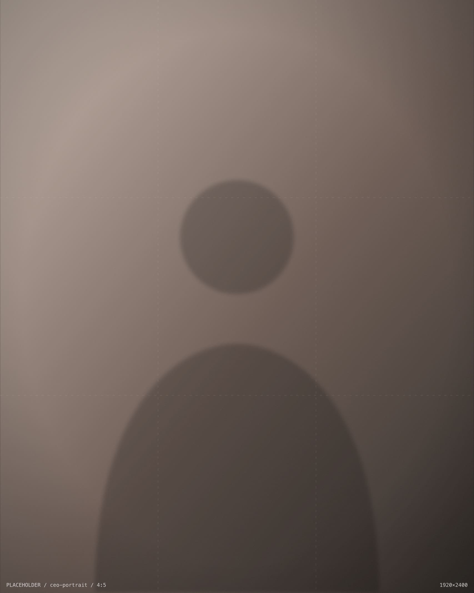

| 項目 | 内容 |
|---|---|
| 優先度 | A |
| 使用ページ | /about, /about/message |
| 比率・解像度 | 4:5・1920×2400px 以上 |
| 被写体 | 代表取締役。スーツまたはジャケット、ノーネクタイ可 |
| 構図 | 胸から上。目線はレンズ、やや斜め45度。背景は無地の壁か窓際で抜けをつくる |
| 光 | 窓からの自然光を主光源に、逆側にレフ板で起こす。硬い影を避ける |
| 雰囲気 | 誠実・静か・余裕。笑顔は控えめに口角を上げる程度 |
| 人物 | 1名 |
| 撮影場所の候補 | 本社会議室の窓際、または応接室 |
| alt（Web表示用） | 代表取締役のポートレート |
| 状態 | ダミー画像（未撮影） |

### 代表：仕事風景  `ceo-at-work`

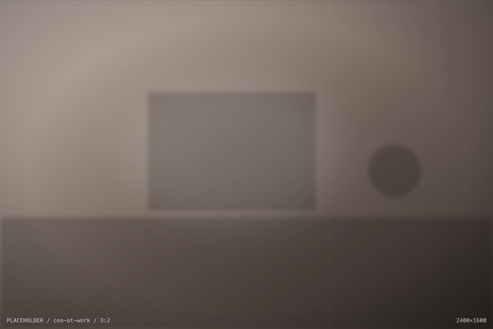

| 項目 | 内容 |
|---|---|
| 優先度 | B |
| 使用ページ | /about/message |
| 比率・解像度 | 3:2・2400×1600px 以上 |
| 被写体 | 代表が打ち合わせ中、または図面・画面を見ている様子 |
| 構図 | 斜め後方から、手元と視線の先を入れる。顔は半分見える程度でよい |
| 光 | 自然光。コントラストは低め |
| 雰囲気 | 考えている最中の静けさ |
| 人物 | 1名 |
| 撮影場所の候補 | 本社オフィス |
| alt（Web表示用） | 打ち合わせ中の代表取締役 |
| 状態 | ダミー画像（未撮影） |

### 役員ポートレート 01  `officer-01`

| 項目 | 内容 |
|---|---|
| 優先度 | A |
| 使用ページ | /about |
| 比率・解像度 | 1:1・1600×1600px 以上 |
| 被写体 | 取締役 |
| 構図 | 胸から上、正面やや斜め。代表と同じ背景・同じライティングで統一する |
| 光 | 代表ポートレートと同一セットアップ |
| 雰囲気 | 落ち着き・信頼 |
| 人物 | 1名 |
| 撮影場所の候補 | 代表ポートレートと同じ場所 |
| alt（Web表示用） | 取締役のポートレート |
| 状態 | ダミー画像（未撮影） |

### 役員ポートレート 02  `officer-02`

| 項目 | 内容 |
|---|---|
| 優先度 | A |
| 使用ページ | /about |
| 比率・解像度 | 1:1・1600×1600px 以上 |
| 被写体 | 取締役 |
| 構図 | officer-01 と同一 |
| 光 | officer-01 と同一 |
| 雰囲気 | officer-01 と同一 |
| 人物 | 1名 |
| 撮影場所の候補 | officer-01 と同一 |
| alt（Web表示用） | 取締役のポートレート |
| 状態 | ダミー画像（未撮影） |

### 役員ポートレート 03  `officer-03`

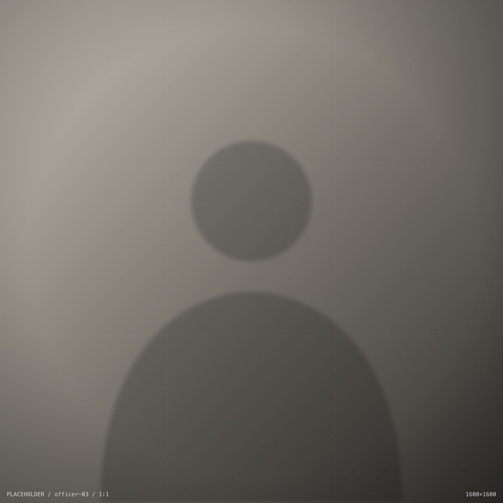

| 項目 | 内容 |
|---|---|
| 優先度 | A |
| 使用ページ | /about |
| 比率・解像度 | 1:1・1600×1600px 以上 |
| 被写体 | 取締役 |
| 構図 | officer-01 と同一 |
| 光 | officer-01 と同一 |
| 雰囲気 | officer-01 と同一 |
| 人物 | 1名 |
| 撮影場所の候補 | officer-01 と同一 |
| alt（Web表示用） | 取締役のポートレート |
| 状態 | ダミー画像（未撮影） |

### オフィス外観  `office-exterior`

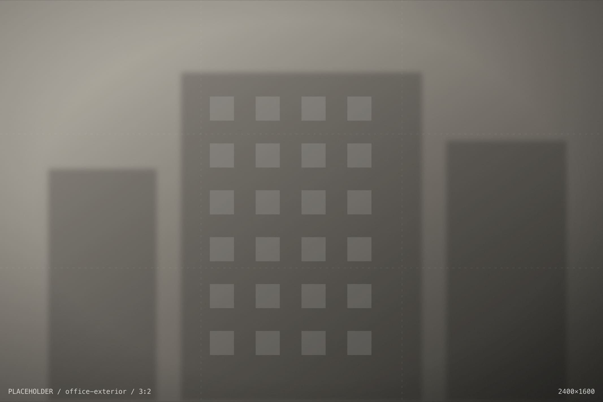

| 項目 | 内容 |
|---|---|
| 優先度 | A |
| 使用ページ | /about, /about#access |
| 比率・解像度 | 3:2・2400×1600px 以上 |
| 被写体 | 本社が入るビルの外観。エントランスと社名表示が分かるように |
| 構図 | 正面やや見上げ。垂直線を保つ（シフトレンズ推奨）。歩行者は入れない |
| 光 | 午前の順光か、曇天の柔らかい光。強い影のある正午は避ける |
| 雰囲気 | 端正・静か |
| 人物 | なし |
| 撮影場所の候補 | 本社ビル前 |
| alt（Web表示用） | 本社ビルの外観 |
| 状態 | ダミー画像（未撮影） |

### オフィス内観  `office-interior`

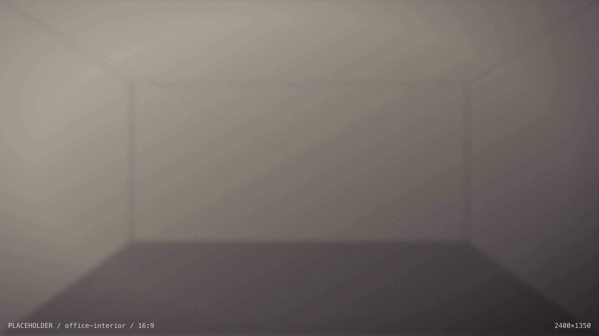

| 項目 | 内容 |
|---|---|
| 優先度 | A |
| 使用ページ | /about, /recruit |
| 比率・解像度 | 16:9・2400×1350px 以上 |
| 被写体 | 執務エリアまたは会議室の全景。人はいなくてよい |
| 構図 | 広角で奥行きを見せる。机上は整え、ケーブルや私物を片付ける |
| 光 | 自然光メイン。室内灯は色温度を揃える |
| 雰囲気 | 整然・余白 |
| 人物 | なし |
| 撮影場所の候補 | 本社オフィス |
| alt（Web表示用） | 本社オフィスの内観 |
| 状態 | ダミー画像（未撮影） |

### 執務風景  `office-working`

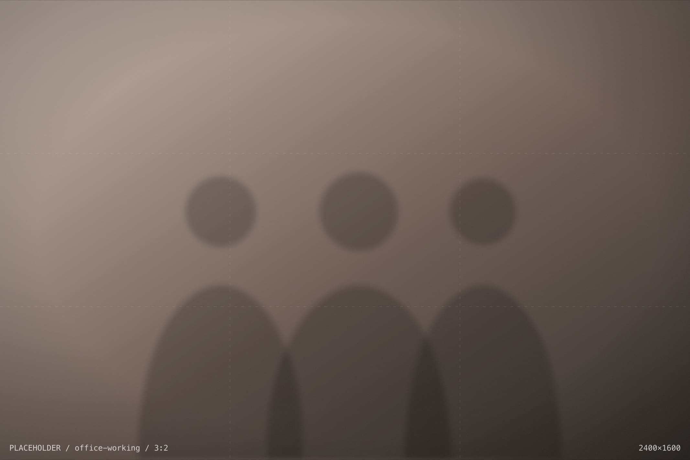

| 項目 | 内容 |
|---|---|
| 優先度 | A |
| 使用ページ | /, /about, /recruit |
| 比率・解像度 | 3:2・2400×1600px 以上 |
| 被写体 | 社員2〜3名が画面や資料を囲んで話している |
| 構図 | ミディアムショット。手元と表情の両方が入る。背景をぼかす（F2.8〜4） |
| 光 | 自然光。被写体に対して斜め前から |
| 雰囲気 | 集中・対話。カメラ目線は不要 |
| 人物 | 2〜3名 |
| 撮影場所の候補 | 本社オフィス |
| alt（Web表示用） | 打ち合わせをする社員 |
| 状態 | ダミー画像（未撮影） |

### キービジュアル：Web開発  `kv-digital`

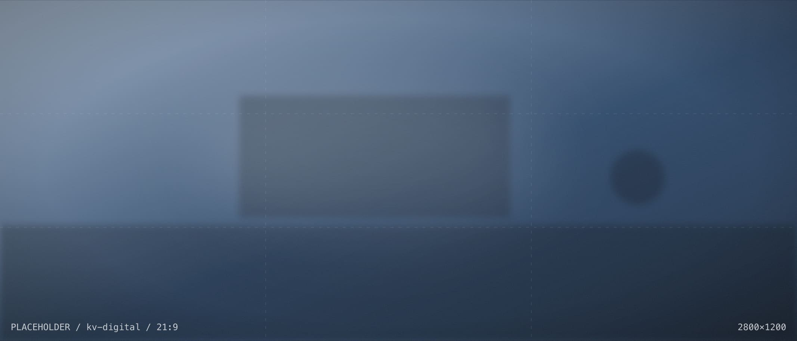

| 項目 | 内容 |
|---|---|
| 優先度 | A |
| 使用ページ | /, /business, /business/digital |
| 比率・解像度 | 21:9・2800×1200px 以上 |
| 被写体 | エンジニア／デザイナーの手元。コードやワイヤーフレームが映るディスプレイ |
| 構図 | 画面と手元を斜め上から。画面内容は読めなくてよい（抽象的な光として扱う） |
| 光 | 画面の光と窓の光のミックス。暗めに落としてコントラストを出す |
| 雰囲気 | 静謐・精密 |
| 人物 | 1名 |
| 撮影場所の候補 | 本社オフィス |
| alt（Web表示用） | Web開発事業のキービジュアル |
| 状態 | ダミー画像（未撮影） |

### キービジュアル：SNS運用  `kv-social`

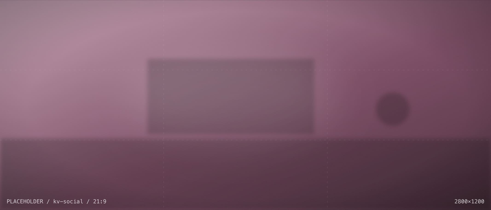

| 項目 | 内容 |
|---|---|
| 優先度 | A |
| 使用ページ | /, /business, /business/social |
| 比率・解像度 | 21:9・2800×1200px 以上 |
| 被写体 | 撮影・編集の現場。スマートフォンでの撮影や、小物を並べた物撮りセット |
| 構図 | 斜めから、手とスマホと被写体の三角形をつくる |
| 光 | 柔らかい面光源。影を薄く |
| 雰囲気 | 軽やか・丁寧 |
| 人物 | 1名 |
| 撮影場所の候補 | 飲食店舗、またはスタジオ |
| alt（Web表示用） | SNS運用代行事業のキービジュアル |
| 状態 | ダミー画像（未撮影） |

### キービジュアル：経営コンサルティング  `kv-consulting`

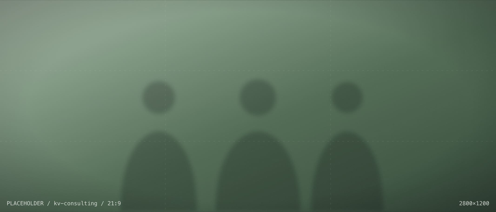

| 項目 | 内容 |
|---|---|
| 優先度 | A |
| 使用ページ | /, /business, /business/consulting |
| 比率・解像度 | 21:9・2800×1200px 以上 |
| 被写体 | 経営者と向き合って話す場面。テーブル上に資料・ノート |
| 構図 | テーブル越しの対面を横から。顔は見切れてよい |
| 光 | 窓際の自然光 |
| 雰囲気 | 対話・信頼 |
| 人物 | 2〜3名 |
| 撮影場所の候補 | 本社応接室 |
| alt（Web表示用） | 経営コンサルティング事業のキービジュアル |
| 状態 | ダミー画像（未撮影） |

### キービジュアル：建設  `kv-build`

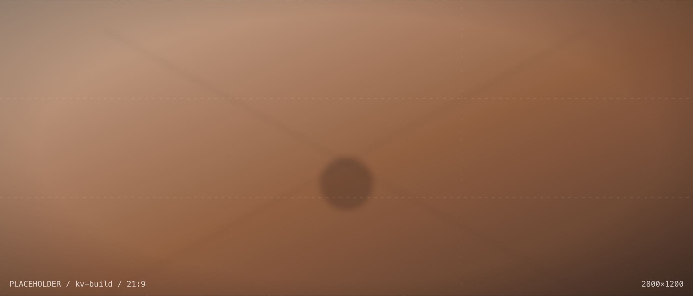

| 項目 | 内容 |
|---|---|
| 優先度 | A |
| 使用ページ | /, /business, /business/build |
| 比率・解像度 | 21:9・2800×1200px 以上 |
| 被写体 | 施工中の現場。職人の手元や、足場・構造材のディテール |
| 構図 | ディテール寄り。ヘルメット・安全装備は必ず正しく着用 |
| 光 | 現場の自然光。朝夕の斜光が望ましい |
| 雰囲気 | 確かさ・手仕事 |
| 人物 | 1名 |
| 撮影場所の候補 | 施工中の現場（施主の許可を得る） |
| alt（Web表示用） | 建設事業のキービジュアル |
| 状態 | ダミー画像（未撮影） |

### キービジュアル：飲食  `kv-dining`

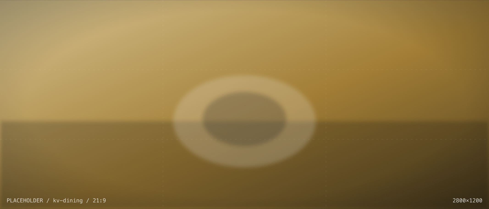

| 項目 | 内容 |
|---|---|
| 優先度 | A |
| 使用ページ | /, /business, /business/dining |
| 比率・解像度 | 21:9・2800×1200px 以上 |
| 被写体 | カウンター越しの調理、または皿に盛られた看板料理 |
| 構図 | 低めのアイレベル。湯気や光の反射を活かす |
| 光 | 店内の暖色照明＋窓の自然光。混色しすぎない |
| 雰囲気 | 温度・活気 |
| 人物 | 1名 |
| 撮影場所の候補 | 自社店舗 |
| alt（Web表示用） | 飲食事業のキービジュアル |
| 状態 | ダミー画像（未撮影） |

### 建設現場（引き）  `build-site-wide`

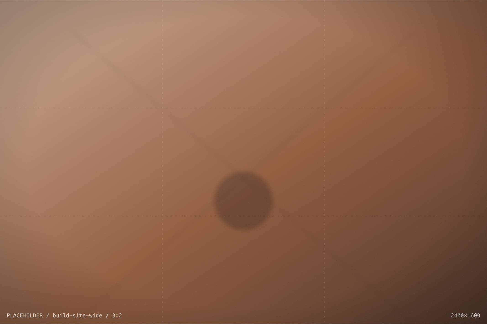

| 項目 | 内容 |
|---|---|
| 優先度 | B |
| 使用ページ | /business/build |
| 比率・解像度 | 3:2・2400×1600px 以上 |
| 被写体 | 現場全体。足場・養生・搬入の様子 |
| 構図 | 引きで全景。整理整頓された現場であることが伝わるように |
| 光 | 日中の自然光 |
| 雰囲気 | 安全・秩序 |
| 人物 | 複数名 |
| 撮影場所の候補 | 施工中の現場 |
| alt（Web表示用） | 施工中の建設現場 |
| 状態 | ダミー画像（未撮影） |

### 施工事例：ビフォー  `build-before`

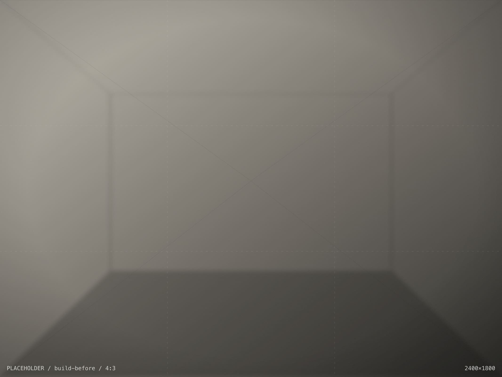

| 項目 | 内容 |
|---|---|
| 優先度 | A |
| 使用ページ | /business/build, /works |
| 比率・解像度 | 4:3・2400×1800px 以上 |
| 被写体 | 改修前の室内または外壁 |
| 構図 | 三脚固定。アフターと同一位置・同一画角・同一焦点距離で撮る（必須） |
| 光 | アフターと同条件に揃える |
| 雰囲気 | 記録として正確に |
| 人物 | なし |
| 撮影場所の候補 | 施工物件 |
| alt（Web表示用） | 施工前の様子 |
| 状態 | ダミー画像（未撮影） |

### 施工事例：アフター  `build-after`

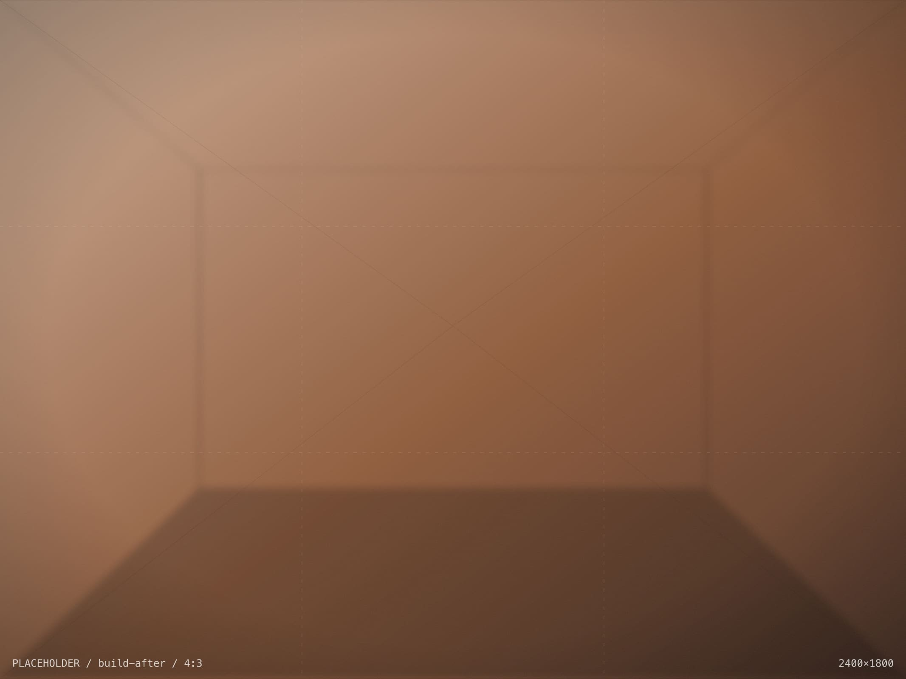

| 項目 | 内容 |
|---|---|
| 優先度 | A |
| 使用ページ | /business/build, /works |
| 比率・解像度 | 4:3・2400×1800px 以上 |
| 被写体 | 改修後の同じ場所 |
| 構図 | ビフォーと完全に同一の位置・画角 |
| 光 | ビフォーと同条件 |
| 雰囲気 | 仕上がりの清潔さ |
| 人物 | なし |
| 撮影場所の候補 | 施工物件 |
| alt（Web表示用） | 施工後の様子 |
| 状態 | ダミー画像（未撮影） |

### 飲食店舗の内観  `dining-interior`

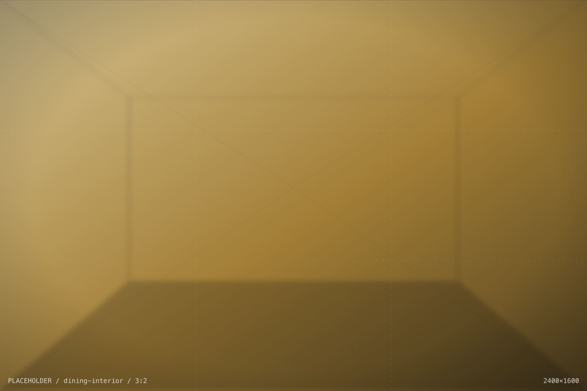

| 項目 | 内容 |
|---|---|
| 優先度 | A |
| 使用ページ | /business/dining |
| 比率・解像度 | 3:2・2400×1600px 以上 |
| 被写体 | 店内全景。開店前の整った状態 |
| 構図 | 入口側から奥へ。テーブルセッティング済み |
| 光 | 店内照明＋外光。暖色に寄せすぎない |
| 雰囲気 | 居心地・清潔 |
| 人物 | なし |
| 撮影場所の候補 | 自社店舗 |
| alt（Web表示用） | 店舗の内観 |
| 状態 | ダミー画像（未撮影） |

### 料理 01（看板メニュー）  `dining-food-01`

| 項目 | 内容 |
|---|---|
| 優先度 | A |
| 使用ページ | /business/dining |
| 比率・解像度 | 1:1・1800×1800px 以上 |
| 被写体 | 看板メニュー1品 |
| 構図 | 真上または45度。皿の縁を少し切る。テーブルの素材感を残す |
| 光 | 逆光〜サイド光で立体感。トップ光は避ける |
| 雰囲気 | シズル・温度 |
| 人物 | なし |
| 撮影場所の候補 | 自社店舗 |
| alt（Web表示用） | 看板メニュー |
| 状態 | ダミー画像（未撮影） |

### 料理 02  `dining-food-02`

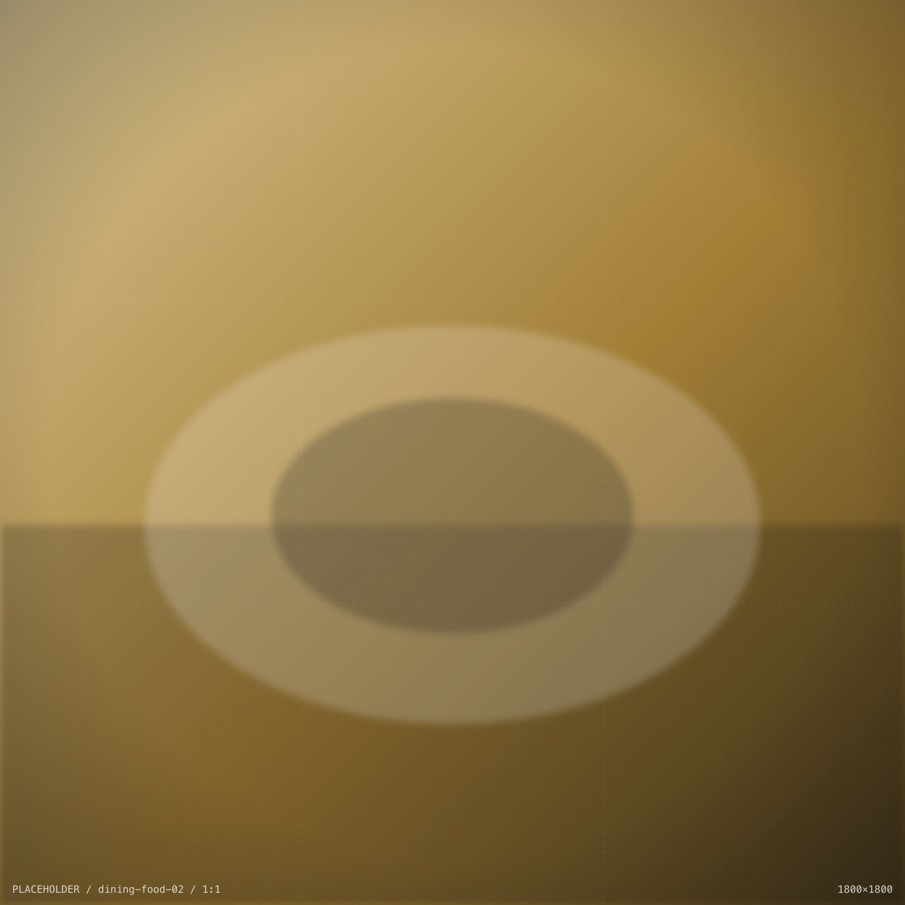

| 項目 | 内容 |
|---|---|
| 優先度 | B |
| 使用ページ | /business/dining |
| 比率・解像度 | 1:1・1800×1800px 以上 |
| 被写体 | 料理2品目（ドリンクやデザートでもよい） |
| 構図 | 料理01と統一。皿の向き・余白を揃える |
| 光 | 料理01と同一 |
| 雰囲気 | 料理01と同一 |
| 人物 | なし |
| 撮影場所の候補 | 自社店舗 |
| alt（Web表示用） | 店舗の料理 |
| 状態 | ダミー画像（未撮影） |

### 飲食店舗の外観  `dining-exterior`

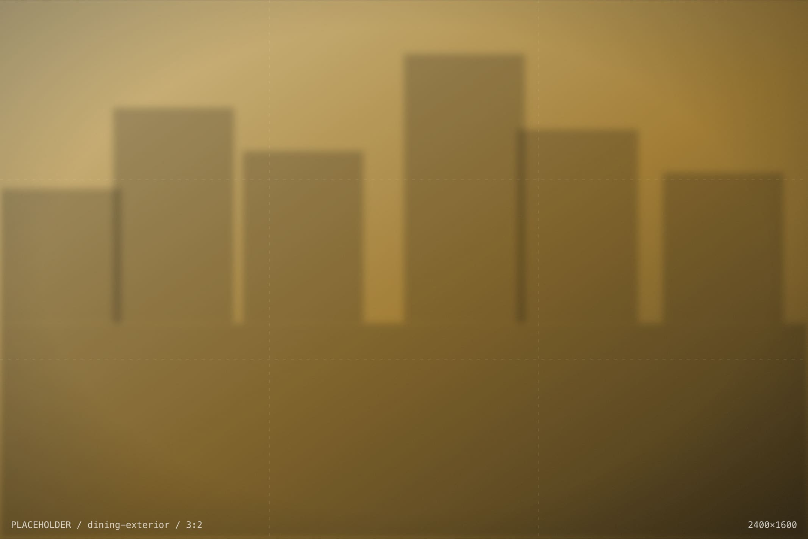

| 項目 | 内容 |
|---|---|
| 優先度 | B |
| 使用ページ | /business/dining |
| 比率・解像度 | 3:2・2400×1600px 以上 |
| 被写体 | 店舗ファサード。看板・入口 |
| 構図 | 正面やや斜め。夕方のブルーアワーに店内の灯りが漏れる時間帯 |
| 光 | ブルーアワー（日没後15〜30分） |
| 雰囲気 | 灯り・誘い |
| 人物 | なし |
| 撮影場所の候補 | 自社店舗前 |
| alt（Web表示用） | 店舗の外観 |
| 状態 | ダミー画像（未撮影） |

### 採用メインビジュアル  `recruit-hero`

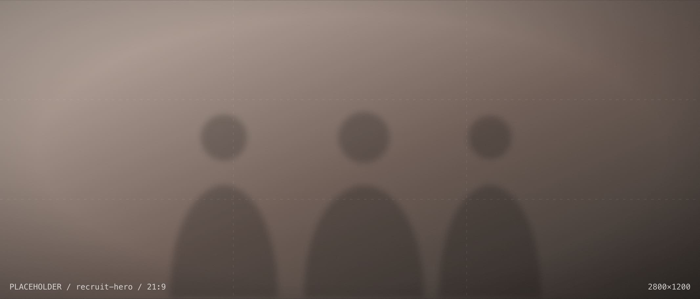

| 項目 | 内容 |
|---|---|
| 優先度 | A |
| 使用ページ | /recruit |
| 比率・解像度 | 21:9・2800×1200px 以上 |
| 被写体 | 複数の事業のメンバーが同じ空間にいる場面（オフィス・現場・店舗の混成でもよい） |
| 構図 | 引きで、人物は小さめに。空間の広さと人の関係を見せる |
| 光 | 自然光 |
| 雰囲気 | 開かれた・これから |
| 人物 | 複数名 |
| 撮影場所の候補 | 本社オフィス、または店舗 |
| alt（Web表示用） | 採用情報のメインビジュアル |
| 状態 | ダミー画像（未撮影） |

### 社員インタビュー 01  `interview-01`

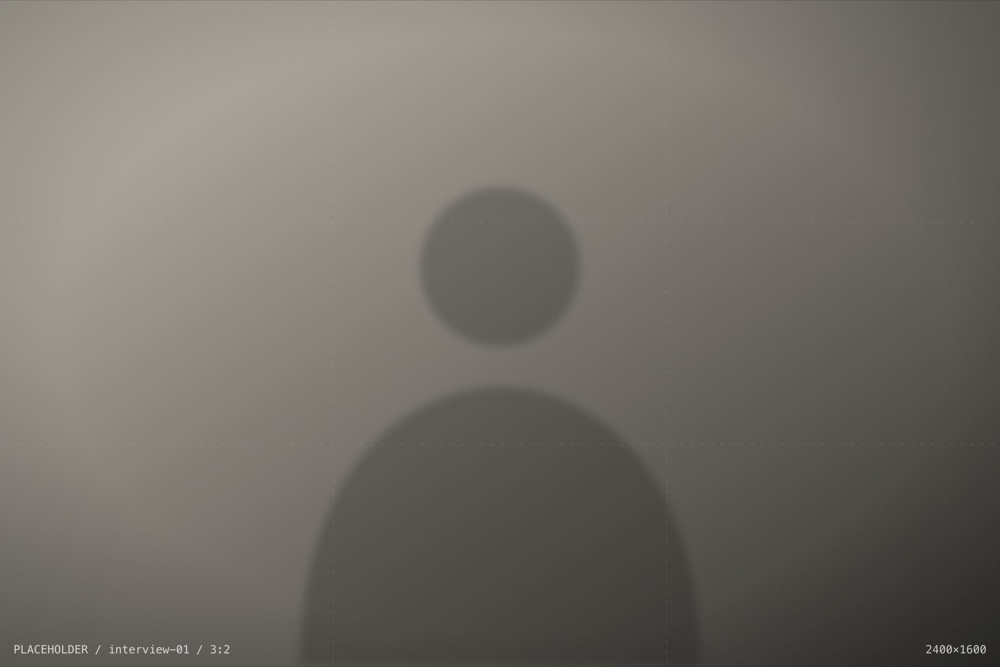

| 項目 | 内容 |
|---|---|
| 優先度 | B |
| 使用ページ | /recruit |
| 比率・解像度 | 3:2・2400×1600px 以上 |
| 被写体 | 社員1名（Web開発またはSNS）。職場で |
| 構図 | ウエストアップ。少しカメラから視線を外した自然な表情も撮る |
| 光 | 自然光 |
| 雰囲気 | 自然体 |
| 人物 | 1名 |
| 撮影場所の候補 | 本人の職場 |
| alt（Web表示用） | 社員インタビュー |
| 状態 | ダミー画像（未撮影） |

### 社員インタビュー 02  `interview-02`

| 項目 | 内容 |
|---|---|
| 優先度 | B |
| 使用ページ | /recruit |
| 比率・解像度 | 3:2・2400×1600px 以上 |
| 被写体 | 社員1名（施工管理）。現場で |
| 構図 | interview-01 と統一 |
| 光 | 現場の自然光 |
| 雰囲気 | 自然体 |
| 人物 | 1名 |
| 撮影場所の候補 | 施工現場 |
| alt（Web表示用） | 社員インタビュー |
| 状態 | ダミー画像（未撮影） |

### 社員インタビュー 03  `interview-03`

| 項目 | 内容 |
|---|---|
| 優先度 | B |
| 使用ページ | /recruit |
| 比率・解像度 | 3:2・2400×1600px 以上 |
| 被写体 | 社員1名（店舗スタッフ）。店舗で |
| 構図 | interview-01 と統一 |
| 光 | 店内の光 |
| 雰囲気 | 自然体 |
| 人物 | 1名 |
| 撮影場所の候補 | 自社店舗 |
| alt（Web表示用） | 社員インタビュー |
| 状態 | ダミー画像（未撮影） |
